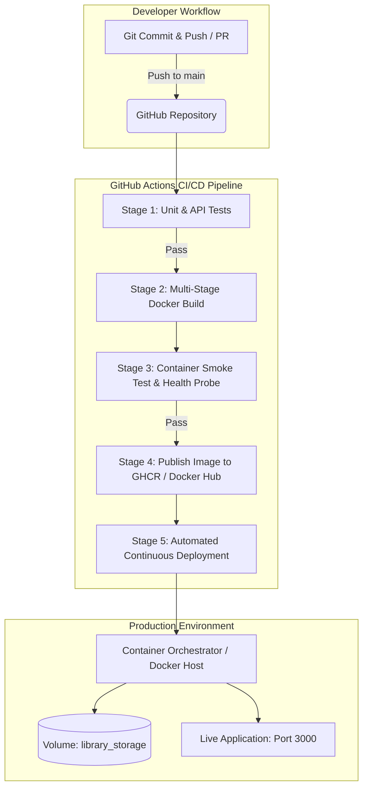

# 📚 Containerized Library Management System with Automated CI/CD

A production-grade, containerized Library Management System built with Node.js, Express, and a responsive glassmorphic web dashboard, complete with automated Docker multi-stage builds and a full GitHub Actions CI/CD deployment pipeline.

---

## 🌟 Key Features

- **Interactive Glassmorphic UI Dashboard**: Live book catalog, real-time search, category filters, and instant borrow/return workflows with optimistic UI updates.
- **RESTful API**: Complete CRUD operations, real-time inventory statistics, and health diagnostics endpoints.
- **Production Containerization**: Multi-stage Docker build, non-root user (`USER node`), automated health check probe, and persistent volume storage.
- **Automated CI/CD Pipeline**: GitHub Actions workflow that automatically runs test suites, builds container images, performs smoke tests, publishes to GitHub Container Registry (GHCR), and triggers automated deployment whenever code is pushed.
- **Zero-Downtime Deployment Scripts**: Ready-to-run automation scripts for Linux/macOS (`scripts/deploy.sh`) and Windows PowerShell (`scripts/deploy.ps1`).

---

## 🏗️ Architecture & Pipeline Flow



---

## 📁 Project Structure

```
d:/cloud/
├── .github/
│   └── workflows/
│       └── ci-cd.yml             # GitHub Actions automated CI/CD pipeline
├── src/
│   ├── app.js                    # Express application factory & middleware
│   ├── server.js                 # Server listener with graceful shutdown
│   ├── routes/
│   │   ├── books.js              # Book management REST endpoints
│   │   └── health.js             # Liveness, readiness & health probes
│   ├── services/
│   │   └── bookService.js        # Business logic & persistent storage
│   └── data/
│       └── initialBooks.json     # Initial seed dataset
├── public/
│   ├── index.html                # Modern Glassmorphic LMS Dashboard
│   ├── css/
│   │   └── style.css             # Vanilla CSS design system
│   └── js/
│       └── app.js                # Frontend client logic & AJAX handling
├── tests/
│   ├── books.test.js             # API integration test suite
│   └── health.test.js            # Diagnostics probe test suite
├── scripts/
│   ├── deploy.sh                 # Linux/macOS deployment automation script
│   ├── deploy.ps1                # Windows PowerShell deployment script
│   └── smoke-test.sh             # API smoke verification script
├── Dockerfile                    # Multi-stage security-hardened containerfile
├── .dockerignore                 # Excludes development artifacts from Docker context
├── docker-compose.yml            # Docker Compose orchestration with volumes
├── package.json                  # Dependencies and scripts
└── README.md                     # Documentation
```

---

## 🚀 Getting Started

### 1. Prerequisites
- **Node.js**: v20+ or v22+
- **Docker & Docker Compose**: (Optional for local container execution)
- **Git**

### 2. Run Locally (Node.js)

```bash
# Install dependencies
npm install

# Run automated tests
npm test

# Start the application
npm start
```
Open **[http://localhost:3000](http://localhost:3000)** in your browser to view the application.

---

## 🐳 Docker Containerization

### Build & Run with Docker

1. **Build the Docker Image**:
   ```bash
   docker build -t library-management-system:latest .
   ```

2. **Run the Container**:
   ```bash
   docker run -d \
     --name library-app \
     -p 3000:3000 \
     -v library_storage:/usr/src/app/data_storage \
     library-management-system:latest
   ```

3. **Check Container Status and Logs**:
   ```bash
   docker ps
   docker logs library-app
   ```

### Run with Docker Compose

To launch the system with persistent data storage configured:

```bash
# Start container in detached mode
docker-compose up -d --build

# View container logs
docker-compose logs -f

# Stop container
docker-compose down
```

---

## 🔄 Automated CI/CD Pipeline

The automated CI/CD pipeline is configured in [`.github/workflows/ci-cd.yml`](file:///d:/cloud/.github/workflows/ci-cd.yml).

### Workflow Stages:
1. **Automated Testing (`test`)**:
   - Runs across Node.js matrix (20.x, 22.x).
   - Validates all API endpoints, business logic, and health probes.
2. **Docker Build & Smoke Test (`build-container`)**:
   - Builds the production multi-stage Docker container.
   - Spins up a test container and probes `http://localhost:3000/health`.
3. **Publish to Registry (`publish`)**:
   - Automatically authenticates with **GitHub Container Registry (`ghcr.io`)** using the repository token.
   - Pushes tags: `latest`, branch name, and commit SHA.
4. **Continuous Deployment (`deploy`)**:
   - Automates deployment to cloud providers (Render, Railway, Fly.io, or remote Docker host) whenever changes land in `main`.

### Connecting Your GitHub Repository:
1. Create a repository on GitHub:
   ```bash
   git add .
   git commit -m "feat: Containerized library management system with CI/CD"
   git remote add origin https://github.com/<your-username>/<your-repo-name>.git
   git branch -M main
   git push -u origin main
   ```
2. Any future commit pushed to `main` will automatically trigger the CI/CD pipeline, run tests, build the Docker image, and deploy the new version.

---

## 📡 REST API Reference

| Method | Endpoint | Description |
|---|---|---|
| `GET` | `/health` | System health, uptime & memory metrics |
| `GET` | `/health/ready` | Kubernetes & Docker readiness probe |
| `GET` | `/health/live` | Container liveness probe |
| `GET` | `/api/books` | List books (supports `search`, `genre`, `availability`) |
| `GET` | `/api/books/stats` | Aggregated catalog counts & metrics |
| `GET` | `/api/books/:id` | Get book details by ID |
| `POST` | `/api/books` | Add new book to catalog |
| `PUT` | `/api/books/:id` | Update existing book |
| `DELETE` | `/api/books/:id` | Remove book from catalog |
| `POST` | `/api/books/:id/borrow` | Borrow a copy (decrements available) |
| `POST` | `/api/books/:id/return` | Return a copy (increments available) |
| `POST` | `/api/books/reset` | Reset catalog to initial sample dataset |
